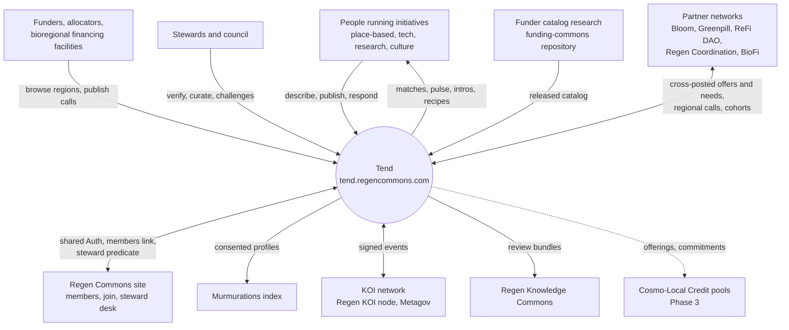
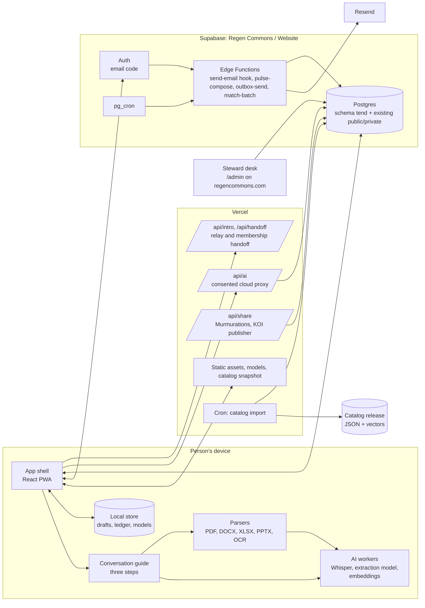
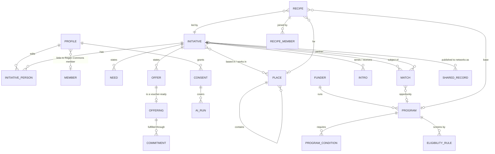
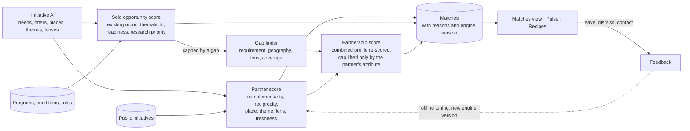
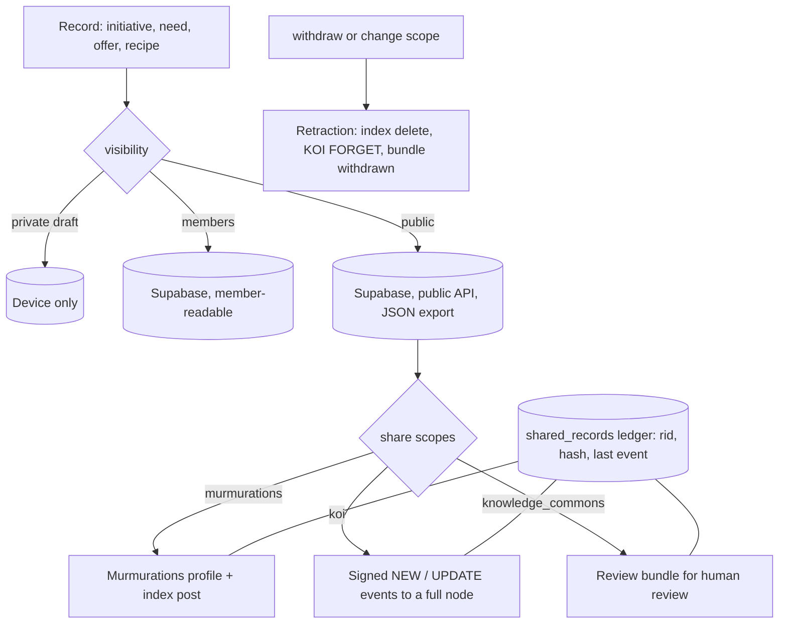
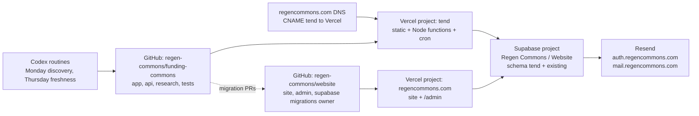

# Logical architecture: Regen Commons Tend (working name)

Status: draft for review · Date: 2026-10-31
Companion documents: [PRD](04-prd.md) · [technical spec](05-technical-spec.md) · [proposal brief](01-proposal-brief.md)

This document describes the shape of the system: the parts, what each owns, how data flows, and how the platform stays one node in a wider commons rather than a new centre. Technology choices and schemas are in the technical spec.

## 1. Five layers

| Layer | Purpose | Owns | Runs |
|---|---|---|---|
| Experience | The three-step conversation, matches, places, recipes, pulse | Drafts, UI state, local AI models | Browser (PWA) |
| Intelligence | Turn speech, text and documents into structured cards; score matches; explain them | Extraction contracts, matching rubric, tiering policy | Browser first; consented cloud; nightly batch |
| Records | The commons' operational truth: initiatives, needs, offers, places, programs, recipes, consents | Schema, row-level security, audit, revisions | Supabase (shared Regen Commons project) |
| Exchange | Everything that leaves or enters the platform: email, Murmurations, KOI events, knowledge commons exports, later commitment pools | Identifiers, hashes, consent scopes, retraction | Vercel functions, Edge Functions |
| Stewardship | Curation, verification, challenges, metrics, catalog research | Steward commands, pulse controls, research workflow | Steward desk on regencommons.com; repository automation |

The ordering is deliberate: a person can get value from the Experience and Intelligence layers with nothing stored anywhere but their device. Records begin only at publish. Exchange begins only with consent. Stewardship tidies; it never gates publishing in the open tier.

## 2. Context



## 3. Containers



What each container owns:

- App shell: routing, theme (shared Regen Commons tokens), offline cache, capability detection, consent dialogs.
- Conversation guide: the state machine for the three steps, prompts, confirmation cards, nudges; works with any tier including "no model".
- AI workers: Whisper transcription, extraction with a small instruct model or the browser's built-in model, the embedding model already shipped by Funding Commons. Nothing in a worker touches the network except pinned model files from the app origin.
- Local store: drafts (IndexedDB), the local AI ledger, cached models (Cache API), cached public corpus for private matching.
- Vercel functions: the only places where provider keys and the KOI signing key exist. Each is a thin, auditable relay.
- Supabase: records, policies, Auth, scheduled jobs, outbox. One project shared with the Regen Commons site; platform objects in their own schema.
- Steward desk: unchanged location and login; gains sections for the platform's records.
- Catalog release: produced by the existing research workflow; the platform is a consumer.

## 4. Domain model



Concepts and their owners:

- Initiative, Need, Offer: owned by the people who publish them; four public initiative fields; everything else derived and editable; dated and confirmable.
- Place: a reference, never typed free-hand into records; bioregion, subrealm, realm, basin, country, custom.
- Funder, Program, conditions, rules: owned by the research workflow; the platform reads, never edits.
- Match: computed, explained, versioned; a person's reactions (save, dismiss, contact) are owned by them.
- Recipe: a partnership forming around a base; owned by its lead; joiners bring ingredients.
- Consent and AI run: the audit spine for anything that leaves the device or the platform.
- Offering and Commitment: the bridge to commitment pooling; off-chain records with hashes until Phase 3.
- Shared record: the ledger of what was sent where, with the identifier and hash, so retraction is precise.

## 5. Flows

### 5.1 Three-step intake on a device

```mermaid
sequenceDiagram
  participant U as Person
  participant G as Guide (browser)
  participant W as AI worker (browser)
  participant C as Cloud proxy (only with consent)
  participant D as Supabase
  U->>G: talk / type / drop a deck / paste a link
  G->>W: transcribe audio (Whisper) · parse files · build text
  W-->>G: transcript + text
  G->>W: extract InitiativeDraft (schema-constrained)
  alt tier cannot run a model
    G->>G: heuristic draft from keywords
    opt person opts in
      G->>C: text only, hashed in ledger
      C-->>G: validated draft
    end
  end
  W-->>G: draft + confidence
  G-->>U: card with four fields and chips to confirm
  U->>G: edits, confirms, continues to needs and offers
  G->>W: embed initiative, needs, offers (local)
  G->>G: private matching against cached public corpus
  G-->>U: first matches before publishing
  U->>D: sign in with email code · publish (visibility, share scopes)
  D-->>U: published; nightly batch refreshes matches; pulse scheduled
```

### 5.2 Matching



### 5.3 Consent and exchange



### 5.4 Weekly pulse

Composer selects eligible initiatives (published, pulse consent, confirmed within 180 days or due for a confirmation prompt), gathers new partner matches, closing opportunities in the initiative's themes and places, nearby needs its offers could meet, recipes needing its ingredient, applies exposure caps, writes one outbox row per recipient with an idempotency key, and the sender delivers through Resend in batches with retries. Every pulse carries the one-tap "still accurate" link that refreshes the record's confirmed date.

## 6. Decentralisation posture

The council's open question was how to avoid building a new centre. The answer is structural, not aspirational:

1. Local first. Drafts, transcription, extraction, embeddings and private matching run on the device. A person can use the conversation and see matches without an account.
2. Owned records. People publish their own records, see where they went, and can withdraw them; retraction propagates to every network they were shared with.
3. Open identifiers and schemas. Every public record has a stable reference identifier and a content hash; profiles are published in Murmurations schemas; exports are JSON and CSV; vocabularies are published.
4. One node among nodes. The platform is a KOI partial node (publisher) and a Murmurations publisher; it does not try to be the index. Knowledge enters the Regen Knowledge Commons only through that project's review, never by direct write.
5. Forkable. Open-source code, an open data licence and a documented deploy let another network run its own instance with its own Supabase project; instances exchange through the same open channels. The Regen Commons instance is the first, not the only.
6. Commons-held operations. The shared Supabase project, the steward predicate and the catalog research live under Regen Commons governance (council, members, stewards) with a published policy for data, consent and retraction.

Where KOI and Coop come in:

- KOI gives the reference-identifier discipline and the event protocol for exchanging records across organisations under consent (the Telescope model: labels travel, material stays home). The platform adopts the identifiers from Phase 0 and the protocol in Phase 2.
- Coop is a pattern library and, later, a capture tool: its provider-tier cascade, JSON repair loop, review-before-share gate and Whisper transcription module are the proven shapes reused here; a Coop receiver on a phone could feed voice and photo captures into the intake as candidate needs and offers. Importing Coop code means AGPL for the platform, which is the proposed licence anyway.

## 7. Deployment view



One migration owner. Two Vercel projects. One Supabase project. One Resend account with two sending subdomains. The research routines keep producing reviewed pull requests; nothing recurring merges or deploys on its own.

## 8. Architecture decisions (summary)

| ID | Decision | Alternatives considered | Consequence |
|---|---|---|---|
| A1 | Local-first AI with consented cloud fallback | Cloud-only; local-only | Works on weak devices without betraying the sovereignty story; needs a consent ledger and tiering |
| A2 | Shared Supabase project, dedicated `tend` schema, single migration owner | Separate project with member sync | Reuses Auth, members and stewards directly; requires migration discipline and namespacing |
| A3 | Steward desk extended, not duplicated | Admin on the subdomain | One login and release for stewards; the website repo must accept a UI module and SQL by pull request |
| A4 | Reuse the Funding Commons rubric for solo scores; add partner and partnership layers | New model-based ranker | Keeps the audited, explainable rubric; partnership logic is additive |
| A5 | Murmurations and KOI as exchange channels; knowledge commons by review bundle | Custom federation API | Standards-first interoperability; no direct writes to shared knowledge |
| A6 | Offerings and off-chain commitments now, pools later | Wallets at launch | Phase 3 anchoring without data migration; no web3 friction in intake |
| A7 | Places as references (One Earth bioregions, HydroBASINS, countries) | Free-text regions only | Enables watershed curation and regional pulses; requires licence confirmation and a geocoder |
| A8 | React PWA on shared tokens | Vanilla HTML like the main site | Worker-heavy conversational UI needs a component model; tokens keep the brand consistent |
