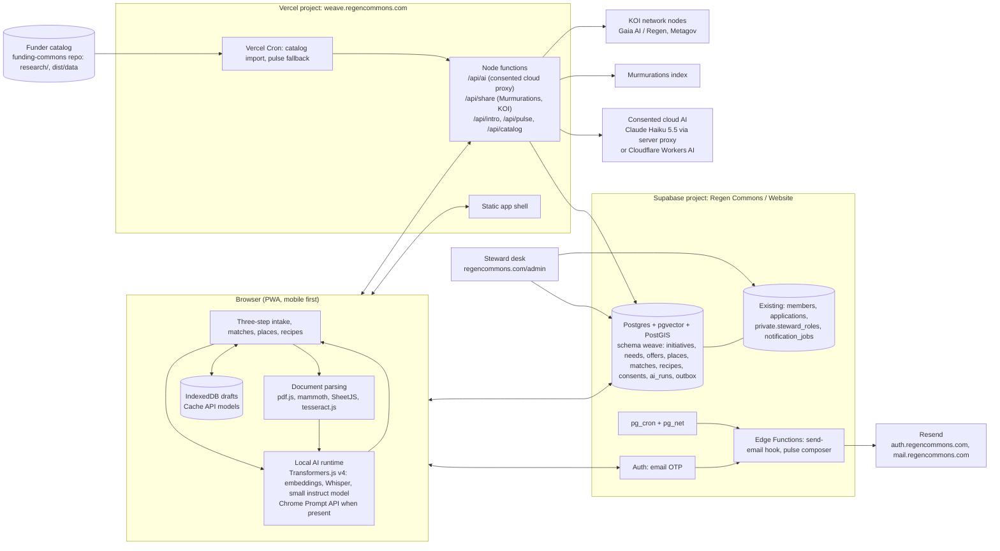

# Technical specification: Regen Commons Weave (working name)

Status: draft for review · Date: 2026-10-31 · Audience: builders and technical reviewers
Companion documents: [PRD](04-prd.md) · [logical architecture](03-logical-architecture.md) · [research digest](06-research-digest.md) (sources for every external fact below) · [saving and accounts](08-accounts-and-saving.md) · [agent scaffolding](07-agent-scaffolding.md) · [open decisions](open-decisions.md) · [design system](../../DESIGN.md)

Requirement identifiers (R1 to R47) refer to the PRD.

## 1. Design principles

1. Local first. Drafts, embeddings for private matching, transcription and extraction run in the browser. The server holds only what a person chose to save or share, plus the funder catalog.
2. Reuse what Regen Commons already runs: the Supabase project "Regen Commons / Website" (Auth, `members`, `steward_roles`, the steward desk), the Resend sending domains, the brand, tokens and fonts, and the Funding Commons research pipeline and matching rubric.
3. Open by default: open schemas, open identifiers, export anytime, open source.
4. Small surface, explicit contracts. Every AI output is validated against a schema. Every write is idempotent and revisioned. Every cross-network share is consented and retractable.
5. Nothing blocks on a model. Every flow works with plain fields and keyword matching.

## 2. System context



## 3. Repositories, stack and deployment

### 3.1 Decisions

| Decision | Choice | Why |
|---|---|---|
| Where the code lives | Evolve `regen-commons/funding-commons` into the platform: `app/` (new PWA), `api/` (Vercel functions), `supabase/` (platform migrations, see 3.3), `research/` and `scripts/` unchanged | Keeps the catalog pipeline, tests and history in one place; the directory UI is rebuilt inside the new app rather than kept as a second site |
| Frontend | TypeScript, Vite, React 19, no CSS framework; Workers for AI | The intake is stateful and worker-heavy; a component model pays for itself |
| Design system | Root `DESIGN.md` in the DesignMD format generates the tokens. `design-system/` holds layered CSS, fonts, brand and voice guides, and a pattern library. React components in `app/src/ui` stay thin and render those classes | One source for the static library, the app and later the website. Website values are preserved and checked against a pinned copy. The website's component CSS is desktop-first, so it is not copied. See the [decision log](../../design-system/decision-log.md) |
| Agent guidance | `AGENTS.md`, skills, rules, hooks and checks, built before UI code | Most code is written by agents. See the [scaffolding plan](07-agent-scaffolding.md) |
| Backend | Supabase (Postgres 17, pgvector, PostGIS, Auth, Storage, Edge Functions, pg_cron) plus Vercel Node functions for anything that needs server-held secrets or outbound calls | One trust boundary for data and auth; Vercel for the app shell and proxies |
| Auth | Supabase Auth email one-time code, verified from the browser with `verifyOtp`, `shouldCreateUser: true` for the platform | Same identity pool as the steward desk; code-first avoids magic-link breakage in mobile mail clients |
| Email | Resend through the Supabase Send Email hook (auth mail) and the Resend REST API from Edge Functions (pulse, intros, notices) | One React Email pipeline, idempotency keys, tags, per-subdomain reputation |
| Hosting | New Vercel project in the existing Regen Commons team, on Hobby now and Pro once needed; `weave.regencommons.com` by CNAME; Node runtime (not Edge) for AI and share proxies | Same platform and team as the website, Funding Commons and the current agent. Hobby is for non-commercial use only, so the team moves to Pro (USD 20 per developer seat) once grant money pays a builder. Edge runtime is deprecated by Vercel and capped at 25 s to first byte |
| Licence | AGPL-3.0 for code (council to confirm); CC BY 4.0 for public data | AGPL keeps the option to import Coop modules; CLC software is also AGPL |

### 3.2 Runtime versions to pin

Transformers.js `@huggingface/transformers` 4.3.2 (upgrade from 4.2.0; 4.3 enables WebGPU on Safari 26 and exposes `getSupportedDevices`), `@huggingface/transformers-structured-output` 4.3.2, `onnxruntime-web` as resolved by Transformers.js, `@supabase/supabase-js` 2.118.0 (matching the website), `zod` 4.x, `pdfjs-dist` 6.4.x, `mammoth` 1.13.x, SheetJS CE 0.20.3 from the vendor tarball, `tesseract.js` 7.x, `jsonrepair` 3.15.x, React 19.2.x, Vite 6.x, Node 22 on Vercel, Bun 1.4.2 for the research scripts as today.

### 3.3 Supabase project and migration ownership

The platform shares the hosted project "Regen Commons / Website" (us-east-1, Postgres 17). Reasons: one Auth user pool, direct foreign keys to `members`, the steward predicate `private.is_active_steward()` reused without duplication, and the council's own guidance that one Supabase project holds all areas in related tables.

Two repositories cannot both push migrations to one project without desynchronising the CLI history. Decision: all platform tables live in a dedicated schema `weave`, and the platform's migrations are authored in this repository under `supabase/migrations/` but applied through a single owner. For Phase 0 the owner is the website repository's migration folder (platform migration files are copied there by pull request, numbered after the latest website migration). From Phase 1 the schema moves to a shared `regen-commons/supabase` repository that both apps consume, with generated TypeScript types published as a package. CI applies every migration from an empty Postgres 17 as the website CI already does.

Rules inherited from the website schema: enable RLS on every table and revoke defaults; write paths through `security definer` functions in `private` with `search_path = ''` and narrow `execute` grants; `security invoker` wrappers in `weave` for PostgREST; revision checks and `request_id` idempotency on every command; actor labels copied from `auth.users.email`; no service-role key in any browser or Vercel function (Vercel functions use the user's JWT or a dedicated restricted role).

### 3.4 Environments

Local: `supabase start` with the combined migrations, `vite dev`, a fixture mode that strips provider keys and serves a synthetic catalog and synthetic initiatives (the website's fixture pattern). Preview: a persistent `staging` branch (Supabase branching per pull request needs the Pro plan); Vercel preview deployments. Production: `main` to Vercel; migrations applied by the owner repository's release step after review.

## 4. Data model

All new objects in schema `weave`. Types are PostgreSQL. Only the essentials are shown; audit columns (`created_at`, `updated_at`, `created_by`, `revision`) exist on every mutable table.

### 4.1 Vocabularies (reference tables, seeded by migration)

```sql
create table weave.capital_forms (code text primary key, label text not null, definition text not null, sort int);
-- financial, material, living, social, intellectual, experiential, cultural, spiritual

create table weave.lenses (code text primary key, label text not null, sort int);
-- art_culture, research, technology, place_based, funders

create table weave.stages (code text primary key, label text not null, sort int);
-- seed, sprout, flowering, tree   (Regen Commons stages of growth)

create table weave.exchange_terms (code text primary key, label text not null);
-- gift, exchange, paid, commitment, open   (Offers and Needs Market vocabulary plus commitment)
```

Themes reuse the funder catalog's theme vocabulary (the `sectors` and program `focus` strings), normalised into `weave.themes(code, label, aliases text[])` by the catalog importer so initiative tags and program tags share one space.

### 4.2 Accounts and membership

```sql
create table weave.profiles (
  user_id uuid primary key references auth.users(id) on delete cascade,
  display_name text,                                    -- never asked for at sign-in; set later if the person wants one
  email text not null,
  member_id uuid references public.members(id),      -- link to a Regen Commons member profile when one exists
  membership_status text,                               -- mirror of members.membership_status, refreshed by trigger
  locale text not null default 'en',
  digest_frequency text not null default 'off' check (digest_frequency in ('weekly','fortnightly','off')),  -- opt-in only
  created_at timestamptz not null default now()
);
```

`weave.profiles` is created on first sign-in by a `security definer` function. `members` is never written by the platform; the membership path pre-fills the public `join` application and the steward desk links the profile when approved (existing `link-profile` command, extended to set `weave.profiles.member_id`).

### 4.3 Initiatives, needs, offers

```sql
create table weave.initiatives (
  id uuid primary key default gen_random_uuid(),
  slug text unique not null,
  name text not null check (length(name) between 1 and 200),
  description text not null check (length(description) <= 4000),
  summary text check (length(summary) <= 300),           -- one-liner derived, editable
  links jsonb not null default '[]',                     -- [{kind:'website'|'social'|'repo'|'deck', url}]
  stage text references weave.stages(code),
  lenses text[] not null default '{}',
  themes text[] not null default '{}',
  beneficiaries text[] not null default '{}',
  languages text[] not null default '{}',
  scale text,                                            -- local, regional, national, global, free text allowed
  eligibility jsonb not null default '{}',               -- optional: legalForm, registrationCountry, applicantType, fundingInstruments, orgSize
  visibility text not null default 'private' check (visibility in ('private','network','public')),  -- a draft never reaches this table
  status text not null default 'active' check (status in ('active','withdrawn')),
  steward_hidden boolean not null default false,         -- set by a steward with a reason; never applies to private rows
  share_scopes text[] not null default '{}',             -- 'murmurations','knowledge_commons','koi'; off by default
  confirmed_at timestamptz,                              -- last "still accurate" confirmation
  embedding vector(256),                                 -- mxbai-embed-xsmall-v1, computed in the browser
  rid text unique,                                       -- orn:regencommons.initiative:<uuid>
  content_sha256 text,
  owner_user_id uuid not null references auth.users(id),
  revision int not null default 1
);

create table weave.initiative_people (
  initiative_id uuid references weave.initiatives(id) on delete cascade,
  user_id uuid references auth.users(id) on delete cascade,
  role text not null default 'editor' check (role in ('owner','editor','contact')),
  primary key (initiative_id, user_id)
);

create table weave.needs (
  id uuid primary key default gen_random_uuid(),
  initiative_id uuid not null references weave.initiatives(id) on delete cascade,
  title text not null check (length(title) <= 140),
  description text check (length(description) <= 2000),
  capital_forms text[] not null check (cardinality(capital_forms) between 1 and 8),
  amount_min numeric, amount_max numeric, currency text,  -- financial only
  timeframe text, urgency text check (urgency in ('now','this_quarter','this_year','ongoing')),
  place_scope text not null default 'anywhere' check (place_scope in ('here','region','anywhere')),
  exchange_terms text[] not null default '{open}',
  purpose text check (length(purpose) <= 1000),           -- what you would do with it
  status text not null default 'open' check (status in ('open','met','withdrawn','expired')),
  expires_at timestamptz,
  embedding vector(256),
  rid text unique, content_sha256 text,
  revision int not null default 1
);

create table weave.offers (
  like weave.needs including all,                        -- same shape, plus:
  capacity text,                                          -- how much, how often
  audience text,                                          -- who it is for
  is_offering boolean not null default false,            -- carries commitment-pool voucher fields when true
  offering jsonb                                          -- {unit, capacity, place, timing, restrictions, terms, redemption, complaints}
);
```

Hybrid search: a generated `tsvector` column with a GIN index on `name || description || summary` for initiatives and on `title || description` for needs and offers; HNSW indexes with `vector_cosine_ops` on the embeddings (optional below a few thousand rows).

### 4.4 Places

```sql
create extension if not exists postgis with schema extensions;

create table weave.places (
  id uuid primary key default gen_random_uuid(),
  kind text not null check (kind in ('realm','subrealm','bioregion','ecoregion','basin','country','admin','custom')),
  code text not null,                                     -- dataset identifier, e.g. One Earth bioregion code, HydroBASINS HYBAS_ID, ISO 3166
  name text not null,
  parent_id uuid references weave.places(id),
  dataset text not null,                                  -- 'oneearth-2023','hydrobasins-v1c','resolve-2017','naturalearth','custom'
  level int,                                              -- Pfafstetter level for basins
  geom extensions.geography(multipolygon, 4326),
  centroid extensions.geography(point, 4326),
  unique (dataset, code)
);
create index places_geom_gix on weave.places using gist (geom);

create table weave.initiative_places (
  initiative_id uuid references weave.initiatives(id) on delete cascade,
  place_id uuid references weave.places(id),
  relation text not null check (relation in ('based_in','works_in')),
  source text not null check (source in ('pin','search','text','steward')),
  primary key (initiative_id, place_id, relation)
);
alter table weave.initiatives add column is_global boolean not null default false;
```

Assignment function `weave.places_for_point(lon, lat)` returns the containing bioregion, subrealm, realm, basin (one row per configured level) and country using `ST_Intersects`. Free-text locations resolve through a server-side geocoder (Nominatim with attribution, or Mapbox if a key exists) to a point, then through the same function; the derived places are shown so the user can correct them. Each place row stores attribution text for display.

### 4.5 Opportunities (funder catalog)

The catalog keeps its JSON contract (`dist/data/enrichment.schema.json`, `funders.json`, `program-conditions.json`, `eligibility-rules.json`, `fund-vectors`). The importer loads it into:

```sql
create table weave.funders (id text primary key, name text, display_name text, website text, record jsonb not null, imported_at timestamptz);
create table weave.programs (
  id text primary key,                                    -- documentId: <fundId>::<programId>
  funder_id text references weave.funders(id),
  name text, instrument text, route text,
  opens_on date, closes_on date, deadline_instant timestamptz,
  themes text[], regions text[], work_countries text[], applicant_countries text[],
  record jsonb not null,                                  -- the program object verbatim
  embedding vector(256),                                  -- from fund-vectors, same model contract
  rid text unique
);
create table weave.program_conditions (key text primary key, program_id text references weave.programs(id), record jsonb not null);
create table weave.eligibility_rules (id text primary key, program_id text references weave.programs(id), record jsonb not null);
```

Import runs on deploy and daily by Vercel Cron (once a day is the Hobby limit), verifying the release manifest hash and model contract before replacing rows in one transaction. The research workflow (Monday discovery, Thursday freshness, draft pull requests) is unchanged.

### 4.6 Matches, recipes, introductions

```sql
create table weave.matches (
  id uuid primary key default gen_random_uuid(),
  subject_initiative_id uuid not null references weave.initiatives(id) on delete cascade,
  kind text not null check (kind in ('partner','opportunity','opportunity_partnership')),
  object_id text not null,                                -- initiative uuid, program id, or program id + partner uuid
  partner_initiative_id uuid references weave.initiatives(id),
  score numeric not null, band text not null,
  breakdown jsonb not null, reasons text[] not null,
  state text not null default 'suggested' check (state in ('suggested','saved','dismissed','contacted','expired')),
  dismiss_reason text,
  engine_version text not null, computed_at timestamptz not null default now(),
  unique (subject_initiative_id, kind, object_id)
);

create table weave.recipes (
  id uuid primary key default gen_random_uuid(),
  base_kind text not null check (base_kind in ('program','problem')),
  program_id text references weave.programs(id),
  problem text,                                           -- when base_kind = 'problem'
  title text not null, idea text not null,               -- "the idea in a line"
  ingredients jsonb not null default '[]',               -- [{lens, capital_forms[], ask}]
  lead_initiative_id uuid not null references weave.initiatives(id),
  place_id uuid references weave.places(id),
  status text not null default 'forming' check (status in ('forming','drafting','submitted','funded','not_this_time','closed')),
  deadline date, working_doc_url text,
  visibility text not null default 'members' check (visibility in ('members','public')),
  revision int not null default 1
);
create table weave.recipe_members (recipe_id uuid references weave.recipes(id) on delete cascade, initiative_id uuid references weave.initiatives(id), brings text, joined_at timestamptz default now(), primary key (recipe_id, initiative_id));

create table weave.intros (
  id uuid primary key default gen_random_uuid(),
  from_initiative_id uuid references weave.initiatives(id), to_initiative_id uuid references weave.initiatives(id),
  match_id uuid references weave.matches(id),
  message text not null check (length(message) <= 1500),
  status text not null default 'sent' check (status in ('sent','accepted','declined','expired')),
  revealed_at timestamptz
);
```

Introductions relay through email; addresses are revealed to both sides only when `status = 'accepted'`.

### 4.7 Consent, AI ledger, sharing, outbox

```sql
create table weave.consents (
  id uuid primary key default gen_random_uuid(),
  user_id uuid not null references auth.users(id) on delete cascade,
  scope text not null check (scope in ('cloud_ai','cloud_transcription','share_murmurations','share_koi','share_knowledge_commons','intro_relay','pulse')),
  initiative_id uuid references weave.initiatives(id),
  policy_version text not null, granted_at timestamptz not null default now(), withdrawn_at timestamptz
);

create table weave.ai_runs (
  id uuid primary key default gen_random_uuid(),
  user_id uuid references auth.users(id) on delete set null,
  tier text not null check (tier in ('t0_browser_model','t1_desktop_webgpu','t2_mobile_webgpu','t3_wasm','t4_cloud','heuristic')),
  provider text, model text, purpose text not null,       -- 'extract_initiative','extract_needs','extract_offers','transcribe','summarise_link'
  consent_id uuid references weave.consents(id),
  input_sha256 text, output_sha256 text, input_tokens int, output_tokens int, latency_ms int,
  created_at timestamptz not null default now()
);
-- Local runs are logged only in the browser by default; the user may opt in to sending local-run metadata (no text) for evaluation.

create table weave.shared_records (
  record_table text not null, record_id uuid not null, network text not null check (network in ('murmurations','koi','knowledge_commons')),
  rid text, remote_id text, content_sha256 text, last_event text check (last_event in ('new','update','forget')),
  last_sent_at timestamptz, primary key (record_table, record_id, network)
);

create table weave.outbox (
  id uuid primary key default gen_random_uuid(),
  channel text not null check (channel in ('pulse','intro','recipe','steward','system')),
  recipient_user_id uuid references auth.users(id), to_email text not null,
  template text not null, payload jsonb not null, idempotency_key text unique not null,
  status text not null default 'pending' check (status in ('pending','sending','sent','failed','skipped')),
  attempts int not null default 0, last_attempt_at timestamptz, provider_message_id text, failure_code text
);
```

### 4.8 Row-level security (summary)

- `profiles`: owner read and update.
- `initiatives`, `needs`, `offers`: owner and `initiative_people` editors full access through commands; `anon` and `authenticated` may select rows with `visibility = 'public'`; `authenticated` with `profiles.membership_status = 'active'` or any signed-in account (configurable tier, R28) may select `visibility = 'network'`; stewards select `network` and `public` rows through the existing `private.is_active_steward()` predicate and never `private` rows. Aggregate counts come from views that expose no row data.
- `matches`: subject owner reads; written only by the matching job (restricted role).
- `recipes`, `recipe_members`, `intros`: members read per visibility; writes through commands.
- `consents`, `ai_runs`: owner read; insert through commands; never updated except `withdrawn_at`.
- `places`, vocabularies, `funders`, `programs`: public read.
- Policies use `(select auth.uid())`, one policy per command, membership checks in `private` functions, and an index on every column a policy compares.

## 5. Identity and access

- Saving and sign-in are one flow, described in [saving and accounts](08-accounts-and-saving.md). No row exists until a code is confirmed, and the first row is created by a command that takes the local draft ID as its idempotency key, so a retry cannot duplicate it. Local drafts are merged at sign-in without overwriting.
- Sign-in: `supabase.auth.signInWithOtp({ email, options: { shouldCreateUser: true } })` then `verifyOtp({ email, token, type: 'email' })`. The UI is code-first (six or eight digits as configured project-wide; the project currently uses eight-digit codes with a one-hour expiry). A secondary link with `token_hash` to `/auth/confirm` is included for people who prefer tapping. Rate limits: Supabase's per-IP limits plus the hook's own sender limit; the app throttles resend to once per 60 s.
- Email template: the project's OTP template is shared with the steward desk and currently worded for stewards. Decision: move auth mail to the Send Email hook so the template can branch on `email_data.redirect_to` host (platform vs desk) and on locale, with the website's branded table layout.
- Sessions: supabase-js in the browser (publishable key, RLS enforced). The steward desk keeps its host-only cookie model; the two do not share a session, which is acceptable because stewards use the desk on `regencommons.com`.
- Access tiers (R28): a `weave.settings` row `access_tier in ('open','members_first','members_only')` read by policies through a stable function; the council changes it without a deploy.
- Membership link (R26): an account is not membership. "Apply for membership", offered in context and never straight after saving, opens `regencommons.com/join` with the initiative's name, location, links and description pre-filled through a signed, short-lived handoff token; after approval the steward desk links `weave.profiles.member_id` (extension of the existing `link-profile` command and `member_events` audit).

## 6. AI pipeline

### 6.1 Tiering and capability detection (R9)

| Tier | Detection | Engine and model | Footprint |
|---|---|---|---|
| T0 browser model | `LanguageModel.availability() !== 'unavailable'` (Chrome 148+ desktop, Edge preview) | Prompt API with `responseConstraint` = JSON Schema from Zod | 0 MB app download |
| T1 desktop WebGPU | `navigator.gpu` adapter with `maxBufferSize >= 2 GiB`, `deviceMemory` unknown or >= 8, storage quota headroom >= 3 GB, not touch-only | Transformers.js `device: 'webgpu'`, `dtype: 'q4f16'`, Qwen3-1.7B (1.43 GB) default; SmolLM3-3B optional | 1.4 to 2.1 GB cached once |
| T2 mobile WebGPU | WebGPU present but `maxBufferSize < 2 GiB` or iOS/iPadOS 26 or `deviceMemory <= 4` | Transformers.js Qwen3-0.6B q4f16 (570 MB), context capped at 2k tokens, total weights under 600 MB | 570 MB |
| T3 WASM | no WebGPU | Embeddings and reranking stay local (existing mxbai model, 24 MB); extraction uses heuristics or T4 with consent | 40 MB |
| T4 cloud (consented) | user opts in | Server proxy to Claude Haiku 5.5 (zero data retention organisation, EU inference where available) or Cloudflare Workers AI (Gemma 4 26B-A4B) | none |
| Heuristic | always | keyword banks per capital form and lens, sentence splitting, regex for amounts and dates | none |

Rules: show the exact download size from `ModelRegistry.get_file_metadata` before fetching; request `navigator.storage.persist()`; run all inference in a Web Worker; watch `device.lost`; warm the model in the background and answer with the heuristic draft immediately (the Coop cold-start policy); tear down idle models after 15 minutes; never auto-download more than 600 MB on a touch device; encourage home-screen install on iOS to escape the seven-day storage purge.

### 6.2 Contracts (Zod, single source of truth)

```ts
export const CapitalForm = z.enum(['financial','material','living','social','intellectual','experiential','cultural','spiritual']);
export const Lens = z.enum(['art_culture','research','technology','place_based','funders']);
export const Stage = z.enum(['seed','sprout','flowering','tree']);
export const ExchangeTerm = z.enum(['gift','exchange','paid','commitment','open']);

export const InitiativeDraft = z.object({
  name: z.string().min(1).max(200),
  locations: z.array(z.string().max(120)).max(8),
  isGlobal: z.boolean(),
  description: z.string().max(800),
  links: z.array(z.string().url()).max(6),
  stage: Stage.nullable(),
  lenses: z.array(Lens).max(5),
  themes: z.array(z.string().max(60)).max(10),   // post-validated against weave.themes with embedding nearest-neighbour snapping
  beneficiaries: z.array(z.string().max(80)).max(6),
  languages: z.array(z.string().length(2)).max(6),
  confidence: z.number().min(0).max(1),
});

export const NeedCard = z.object({
  title: z.string().max(140),
  description: z.string().max(600).nullable(),
  capitalForms: z.array(CapitalForm).min(1).max(4),
  amount: z.object({ min: z.number().nullable(), max: z.number().nullable(), currency: z.string().length(3).nullable() }).nullable(),
  urgency: z.enum(['now','this_quarter','this_year','ongoing']).nullable(),
  placeScope: z.enum(['here','region','anywhere']),
  exchangeTerms: z.array(ExchangeTerm).min(1),
  purpose: z.string().max(400).nullable(),
});
export const OfferCard = NeedCard.omit({ purpose: true }).extend({ capacity: z.string().max(200).nullable(), audience: z.string().max(200).nullable() });
export const NeedsExtraction = z.object({ needs: z.array(NeedCard).max(6) });
export const OffersExtraction = z.object({ offers: z.array(OfferCard).max(6) });
```

`z.toJSONSchema()` produces the schema used by the Prompt API `responseConstraint`, by `@huggingface/transformers-structured-output`, and by the cloud proxy's structured output. Schema design for small models: flat objects, closed enums listed in the prompt, nullable fields instead of required free text, no `maxLength` constraints in the grammar (they distort output), greedy decoding.

### 6.3 Extraction pipeline

1. Gather: transcript text, typed text, parsed document text, fetched link summary (server-side fetch with a 1 MB cap and readability extraction; the summary is produced locally from the extracted text).
2. Chunk to about 1,500 tokens; extract per chunk; merge cards by embedding similarity (cosine >= 0.9 means the same card); final pass over the merged set.
3. Validate with Zod; on failure run `jsonrepair` and re-parse; then re-prompt once with the issue list; after two failures keep valid fields and mark the rest "needs your touch".
4. Snap themes to the catalog vocabulary by nearest neighbour on the shared embedding model; show unmatched themes as free tags.
5. Present cards; the user edits and confirms. Nothing is saved server-side until the person saves.
6. Log a local `ai_run` record in IndexedDB (tier, model, latency, schema pass, repair used). Users can opt in to send these metrics (no text) to improve tiering.

Evaluation: a fixtures folder with golden, noisy, low-signal and adversarial samples per step (the Coop method); CI measures schema pass rate, repair rate and median latency per tier on a reference machine; a release gate requires >= 95 percent schema pass on golden samples for the default model of each tier.

### 6.4 Transcription (R7)

Whisper through Transformers.js: `whisper-base` (about 77 MB int8, multilingual) on T2 and T3, `whisper-large-v3-turbo` q4f16 (about 0.56 GB) on T1. Capture with `AudioWorklet` at 16 kHz mono Float32; 30 s chunks with 5 s stride; language auto-detect; the transcript is shown and editable before extraction. The Web Speech API is offered only on Chrome when `SpeechRecognition.available({ processLocally: true })` succeeds; never on Safari without a notice that audio may leave the device. Cloud transcription (Cloudflare Workers AI Whisper or Claude audio when available) only under a separate `cloud_transcription` consent.

### 6.5 Document and image input (R1, R8)

PDF text through pdf.js; when a page yields no text, render to canvas and OCR with tesseract.js (cap at 10 pages on mobile; offer cloud OCR under consent). DOCX through mammoth. XLSX and CSV through SheetJS. PPTX through OOXML unzip and `<a:t>` run extraction. Images: optional SmolVLM-256M (about 190 MB q4f16) caption on T1 and T2 to describe project photos; otherwise the image is kept as an attachment only. File size caps: 25 MB per file, processed entirely in the browser; files are uploaded to Supabase Storage only if the user attaches them to the published initiative.

### 6.6 Consented cloud fallback (R10)

- Server proxy `/api/ai` on the Vercel Node runtime (300 s maximum on Hobby); the browser never holds provider keys. Zero data retention requires server-side calls anyway (no CORS under ZDR).
- Default provider: Anthropic `claude-haiku-5-5` with structured outputs (`output_config.format`) and `inference_geo` set to the EU where supported; monthly per-user token budget; alternative provider Cloudflare Workers AI for cost or as a fallback. A self-hosted vLLM or Ollama endpoint on a community server (Hetzner GEX45 class) can be configured as a third provider in Phase 2.
- Consent dialog states provider, model, region, retention, what is sent (text only; audio and files never), and links to the ledger. Consent is per session or per field; withdrawal is one tap and is recorded.
- The proxy stores only `input_sha256`, `output_sha256`, token counts and latency in `weave.ai_runs`, linked to the consent row; it strips email addresses and phone numbers before sending; the response is validated against the same Zod schema.
- A "Where did my data go?" panel lists each cloud call with the retention statement in force and offers CSV export.

## 7. Matching engine

### 7.1 Representations

- Text embeddings: `mixedbread-ai/mxbai-embed-xsmall-v1` (256 dimensions, q8, the existing pinned contract) for initiative descriptions, needs, offers and program documents. Computed in the browser at save time; stored on publish. The public fund vectors continue to be generated at build time.
- Structured features: capital forms, lenses, themes (snapped), place set (basin, bioregion, subrealm, realm, country, global flag), stage, eligibility details, freshness (`confirmed_at`), status.

### 7.2 Partner score (R12)

For initiatives A (subject) and B (candidate):

- Complementarity c(A→B) = mean over A's open needs n of max over B's offers o of sim(n, o), where sim combines cosine similarity of embeddings (weight 0.6) and capital-form overlap Jaccard (weight 0.4). Needs with no offer above 0.35 contribute 0.
- Reciprocity c(B→A) computed the same way with roles swapped.
- Place affinity p(A,B): 1.0 same basin, 0.8 same bioregion, 0.5 same subrealm, 0.3 same realm, 0.3 if either is global, 0.1 otherwise, adjusted by need and offer `place_scope` (a need scoped "here" ignores partners outside the basin).
- Theme overlap t(A,B) = Jaccard of snapped themes.
- Lens complementarity l(A,B) = 1 if lenses differ and at least one need of A names a lens B carries, 0.5 if lenses differ, 0.2 if identical.
- Freshness f = 1 if both confirmed within 90 days, 0.7 within 180 days, else 0.3.

Score = f × (0.35·H(c(A→B), c(B→A)) + 0.20·max(c(A→B), c(B→A)) + 0.20·p + 0.15·t + 0.10·l), where H is the harmonic mean (reciprocal recommender practice: mutual interest counts more than one-sided fit). Bands: strong >= 0.65, relevant >= 0.45, partial >= 0.30. Reasons are generated from the top contributing terms (the specific need and offer titles, the shared place name, the shared themes).

### 7.3 Opportunity solo score (R13)

Reuse the existing Funding Commons rubric unchanged: thematic fit (0 to 100 from shared specific terms and semantic similarity with the published anchors), readiness (next practical check) and research priority (purpose, geography, access, award points with the documented caps). The initiative's eligibility details map onto the existing project fields (work countries, benefit countries, applicant base, registration, applicant type, funding instruments, goal range). Program condition answers remain per initiative and per source date.

### 7.4 Partnership score (R14)

For an opportunity O and subject A with a solo score capped by at least one gap:

1. Enumerate gaps from the existing eligibility and readiness output: a prerequisite category (applicant model, beneficiary, leadership, history, partner), a geographic condition (work country, applicant base, registration, local component), an instrument mismatch, or a thematic coverage gap (program focus terms not covered by A's themes).
2. Candidate partners B are public initiatives whose attributes close at least one gap (registration country in the required set, lens required by the program such as research or place-based, themes covering the missing focus terms) and whose partner score with A is at least "partial".
3. Combined profile: union of themes, places, lenses; eligibility details from whichever partner satisfies each check. Re-run the solo rubric on the combined profile to get fit and priority; the cap that B lifts is lifted only if B's attribute satisfies that specific rule.
4. Partnership score = 0.6 × combined research priority (0 to 100, normalised) + 0.25 × partner score (A,B) + 0.15 × gap coverage ratio. Show "stronger with B because: closes <rule>, brings <lens>, works in <place>". At most two partners per opportunity; triads only when two gaps need two different partners.

### 7.5 Computation and fairness (R15, R16)

- Private drafts: computed in the browser against the public corpus (initiatives, needs, offers, programs are downloadable as a signed, versioned snapshot; a few thousand rows is small). Give to get (R16): for drafts and private initiatives the Partners tab shows a teaser (how many partners match, their bands and the kinds of reason, names hidden); names, cards and introductions open once the initiative is shared. The public directory stays browsable, so this is an incentive in the interface, not a secrecy boundary.
- Saved initiatives, including private ones, which get one-way matches and never appear as a partner for anyone else: a nightly job (Supabase Edge Function on pg_cron) recomputes `weave.matches` incrementally for initiatives changed in the last day plus a rolling refresh; `engine_version` is stored with every row so rubric changes are auditable.
- Exposure caps: in pulses, no initiative or funder appears to more than 10 percent of recipients in a week; ties are broken toward records with fewer prior impressions (an envy-reducing rotation, not a full stable matching).
- Feedback: `state` transitions on `matches` and introduction outcomes are the training signal; weights are tuned offline and shipped as a new `engine_version`. No online learning in the first year.

## 8. Places and geodata (R4, R17, R18)

- Bioregions, subrealms, realms: One Earth Bioregions 2023 (185 bioregions nested in 52 subrealms and 14 realms, built from the 2017 ecoregions and extended over coastal waters). The shapefile is obtained through One Earth's dataset request form and is licensed CC BY-NC 4.0 with a required citation; that fits a non-commercial commons but rules out paid platform tiers built on it. Fallback and finer unit: RESOLVE Ecoregions 2017 (846 ecoregions, CC BY 4.0).
- Watersheds: HydroSHEDS HydroBASINS (Pfafstetter levels 3, 5, 6 and 7). HydroBASINS is not CC BY: it is covered by the WWF HydroSHEDS version 1 licence agreement, which allows use inside derivative works (commercial included) but forbids redistributing the data as a standalone product and requires the licence notice and citations. BasinATLAS carries the same basin geometry under CC BY 4.0 at the cost of larger files, so the import script supports either source. Basins carry no names; the platform shows the river name from the nearest named river in OpenStreetMap, the Wikidata basin label where one exists (property P4614), and lets communities name their basin as a commons contribution, storing the label with its source.
- Countries and admin fallbacks: Natural Earth 1:10m (public domain). GADM is not used (no redistribution, non-commercial only). Optional national precision later: USGS Watershed Boundary Dataset (public domain), Canada's drainage areas (Open Government Licence), Copernicus EU-Hydro.
- Territories: Native Land Digital territories, languages and treaties shown as an acknowledgement layer only, fetched live through their keyed API under the 2025 Data Sovereignty Treaty terms (non-commercial, no storage or redistribution, credit required, boundaries disclaimer), never persisted on records.
- Storage: validated and subdivided geometries (`ST_Subdivide`) in `weave.places`, with simplified display copies; expected 2 to 4 GB in PostGIS, which needs Supabase Pro (8 GB included); while on the free plan's 500 MB, Phase 0 stores only place references and simplified display geometries, and assignment runs in the browser (below); place lookups cost single-digit milliseconds after subdivision.
- Assignment: one RPC `weave.places_for_point(lon, lat)` doing point in polygon per layer with a nearest-neighbour fallback within 25 km for coastal points; results cached on `initiative_places` with dataset versions for provenance. In-browser fallback for private drafts: simplified, quantised TopoJSON of bioregions (about 1 to 3 MB compressed) and level 4 or 5 basins globally, with level 6 and 7 loaded per continent on demand, using a bounding-box index and Turf.js point-in-polygon; served as part of the app with the attribution block, never as standalone downloads.
- Named-place resolution: Nominatim (OpenStreetMap, attribution required, one request per second, no autocomplete) through the server with caching; a self-hosted Photon or a paid geocoder if autocomplete is wanted; Who's On First for coarse place to centroid. Users pick a suggestion or drop a pin; "global" skips geocoding.
- Attribution block on the places pages and the API: One Earth citation; RESOLVE CC BY 4.0; the HydroSHEDS licence statement with Lehner, Verdin and Jarvis (2008) and Lehner and Grill (2013); "Made with Natural Earth"; OpenStreetMap contributors (ODbL); Native Land Digital credit and disclaimer.
- Reference places get their own identifiers (`orn:oneearth.bioregion:<code>`, `orn:hydrobasins.lev06:<id>`) so initiatives, needs and opportunities on different nodes can reference the same place without copying geometry.

## 9. Pulse and email (R23, R24)

- Composer: a Supabase Edge Function `pulse-compose` scheduled by `pg_cron` every Monday 07:00 UTC enqueues one `weave.outbox` row per eligible initiative whose owner opted in, and skips empty weeks, with the rendered payload: new partner matches since last pulse (max 3), opportunities closing within 21 days in the initiative's themes and places (max 5, from the existing Funding Pulse logic), open needs in the same basin or bioregion that the initiative's offers could meet (max 3), recipes forming that need an ingredient the initiative carries (max 2), and the one-tap confirmation link (signed token, extends `confirmed_at`).
- Sender: Edge Function `outbox-send` claims rows with a lease, renders React Email templates, calls Resend `/emails/batch` in groups of 100 with `Idempotency-Key = outbox.idempotency_key`, records `provider_message_id` or a fixed failure code, and retries up to three times over 24 hours (the website's retry rule).
- Deliverability: send pulses from `mail.regencommons.com` (new verified subdomain), auth mail from `auth.regencommons.com` (existing), with DMARC on the root; disable click tracking on transactional mail; `List-Unsubscribe` and `List-Unsubscribe-Post` headers on every pulse; a per-profile `digest_frequency`; regional pulses for stewards and funders are opt-in audiences in Resend.
- Volumes: 150 initiatives and 50 regional subscribers means under 1,000 pulse emails a month, inside Resend's monthly free allowance. Saving adds a code and a first email per person, and the free tier caps at 100 a day, so a demo can hit that limit. Move to the USD 20 Pro tier when daily sends approach 100 or before a large public invitation.

## 10. Interoperability (R29 to R32)

### 10.1 Identifiers and hashes

Every public record gets `rid = orn:regencommons.<type>:<uuid>` for `initiative`, `need`, `offer`, `recipe`, `program` and `place`, and `content_sha256` = SHA-256 of the RFC 8785 canonical JSON of its public representation, recomputed by trigger on change. The public HTTPS URL of each record is a second valid RID. The `orn:regencommons.*` types are proposed to the RID registry by pull request.

### 10.2 Murmurations

A Vercel function renders each consented public initiative as a Murmurations `organizations_schema` profile and each consented need or offer as an `offers_wants_schema` profile (exchange type, item type, transaction type mapped from exchange terms, geographic scope from place scope, tags from themes and capital forms, `expires_at` from `expires_at`), serves them under `/murmurations/<rid>.json`, and posts them to the Murmurations index on publish, update and retraction. Inbound: the places pages can show Murmurations profiles near the place as "also in this region", linked out, not copied.

### 10.3 KOI (Knowledge Organization Infrastructure)

Phase 2: the platform acts as a KOI-net partial node (publisher). One ECDSA P-256 key pair held in Vercel secrets; node RID `orn:koi-net.node:regen-commons+<sha256(pubkey)>`; a first-contact handshake with an agreed full node (the Regen KOI coordinator run by Gaia AI, or Metagov's); then signed `NEW`, `UPDATE` and `FORGET` events for records whose `share_scopes` include `koi`, as bundles (manifest + contents) or manifest-only for large objects. Anything the platform wants from the network (funding knowledge, regional research) is pulled by polling `/events/poll`, `/manifests/fetch` and `/bundles/fetch` on a schedule. There is no official TypeScript library, so the implementation is a small module: RFC 8785 canonicalisation, compact-JSON ECDSA signing with raw `r||s` Base64 signatures, and the five request types. Withdrawal of consent emits `FORGET`. The spec is a draft, so the module is isolated behind an interface and pinned to the Python reference behaviour where the draft is ambiguous.

### 10.4 Regen Knowledge Commons

Export, never direct write. A steward can export consented records as candidate knowledge objects in the Knowledge Commons base shape (id, class, title, revision, contentDigest, sourceRefs, evidenceRefs, uncertainties, maturity, publicUseBoundary) with proposed classes `Organization` (initiative), `Place`, `FundingMechanism` (program), and a proposed new `Opportunity` class for open calls, plus `CaseStudy` for funded recipes. The export is a review bundle (JSON plus Markdown) that enters the Knowledge Commons review flow; `capitalLenses` is populated from the platform's capital forms once the Knowledge Commons pins that vocabulary.

### 10.5 Commitment pooling compatibility (R32)

Offers flagged `is_offering` carry the voucher-term fields used by Cosmo-Local Credit (unit, capacity, place, timing, restrictions, terms, redemption, complaints). Accepted exchanges between initiatives are recorded in `weave.commitments(id, offering_id, from_initiative_id, to_initiative_id, quantity, unit, terms, status in ('proposed','accepted','fulfilled','discharged'), signed_json, sha256)`, signed with platform-held keys. Nothing is on-chain. In Phase 3 a pilot bioregion can anchor fulfilled commitments to a pool on Celo through a steward-run custodial signer (the CLC core services) or members' own wallets; events carry the off-chain record hash, so no data migration is needed.

## 11. Steward desk extension (R33)

The existing desk (`regencommons.com/admin`) gains a `weave` section group using the plug-in seam already used by the membership UI: list and detail views for initiatives, needs and offers, recipes, intros, matches, pulse and challenges, each calling new RPC commands in `private` with the same shape as `membership_command` (revision, reason, request id, audit event). Steward reads use the existing `steward_read` pattern on the new tables. The desk stays on the website origin; the platform repository ships the SQL and a small UI module that the website repository imports by pull request. No new admin surface is created on the subdomain.

## 12. Security and privacy

- Content Security Policy on the app shell: `default-src 'self'`; `connect-src` limited to the app origin, the Supabase project, the model asset origin (self-hosted model files under `/models` as today, checksum-verified) and nothing else; `worker-src 'self' blob:`; `wasm-unsafe-eval` for ONNX Runtime; no third-party fonts or analytics.
- Models and runtime are served from the app origin with pinned revisions and SHA-256 checks (the current practice), not from the Hugging Face hub at runtime.
- Write endpoints require a same-origin `Origin` header and JSON; bodies capped (64 KB; files go directly to Storage with RLS).
- Rate limits: sign-in requests throttled client-side and by Supabase; save, share and intro commands limited per account per hour in a `private.limits` table (the website's intake quota pattern).
- Secrets: provider keys, KOI private key and geocoder keys only in Vercel and Supabase secrets; a restricted Postgres role for jobs; no service-role key anywhere in app code.
- Privacy posture documented on a public page: what stays local, what is stored, what is shared where, how to retract, how to export, retention (drafts stay on the device until saved; saved and shared records until withdrawn or deleted; AI ledger 24 months; outbox payloads 30 days). It also says that people who administer the database can technically read stored records under the data policy, so "Only you" describes the product, not the database.
- Abuse: honeypot fields, steward hide with reason, duplicate detection by name and link similarity when a record is shared, no public email addresses, intro relay with accept gate.

## 13. Observability and operations

- Metrics (R35) computed by SQL views and shown in the desk; no third-party analytics in Phase 0 and 1. Error reporting through Vercel and Supabase logs; optional Sentry later behind consent.
- Costs in Phase 0: about USD 0 per month. Vercel Hobby in the existing Regen Commons team (cron once a day, 300 s functions, non-commercial use only); Supabase free plan or the existing Regen Commons project (500 MB database, paused after 7 days without activity, no automatic backups; sharing the website's project keeps it active, and a nightly `pg_dump` from GitHub Actions to private storage stands in for backups); Resend free (3,000 emails a month, 100 a day); domain and DNS existing; geocoder free tier. Upgrades only when needed: Supabase Pro USD 25 per month for the full place layers, daily backups and branching; Resend Pro USD 20 when daily sends approach 100; Vercel Pro USD 20 per developer seat once grant money pays a builder, or when per-minute cron or longer functions are needed. Cloud AI under USD 10 per month at a 20 percent fallback rate on Haiku 5.5 pricing; optional community inference server about EUR 214 per month in Phase 2.
- Backups: Supabase daily backups (Pro); weekly export of public records to the repository as a versioned open-data release.

## 14. Verification

- Unit: Zod contracts, extraction merge logic, scoring functions with golden fixtures (ports of the existing `tests/matching.test.mjs`, `scoring`, `thematic-fit`, `deadlines`).
- SQL: suites run on a disposable Postgres 17 applying all migrations; policy tests for each role (anon, authenticated non-member, member, steward, owner), including that a steward cannot read a private initiative; command idempotency and revision conflicts.
- Design system: `tests/design-system.test.mjs` runs in CI. It covers stale tokens, the DesignMD linter, website values, contrast in both themes, raw values in CSS, undocumented or unused patterns, inventory lineage, copy rules and document links.
- AI: fixture-based schema pass, repair and latency per tier; a manual device matrix (iPhone 11 on iOS 26, mid-range Android, M-series Mac, Windows laptop with integrated GPU, Firefox desktop) recorded before each phase release.
- Browser: Playwright flows for the three steps by typing, by voice fixture and by upload fixture; matches; recipes; saving, including wrong email, wrong code, a mail-app round trip and draft merge; accessibility checks with axe; reduced motion.
- People: one usability round with real users before 30 November, following the [testing plan](../../design-system/principles/usability-testing.md); the regular rhythm is set after launch.
- Email: rendered previews of every template; a staging audience; bounce handling verified before Phase 1.
- Interoperability: Murmurations profile validation against the library schemas; KOI envelope signing verified against the Python reference implementation in CI (a tiny Python job).

## 15. Migration from the current site

1. The static directory becomes a route in the new app; the data files, embedding runtime and matching modules move into `app/` with their tests. Deep links `?fund=<id>` keep working through a redirect map.
2. Local project profiles (`funding-commons:saved:v2`) are importable as a draft initiative; favourites become saved opportunity matches; notes stay local.
3. The September 2026 hub doc rows (seven initiatives, eight recipes) are imported as unclaimed records and shown in pencil; owners claim them by signing in with the contact email recorded in the doc.
4. The research workflow and its tests stay as they are; only the import target changes (JSON release plus the `weave.programs` load).
5. The current Vercel project keeps serving `funding-commons.vercel.app` with a redirect to the subdomain once DNS is live.

## 16. Phase mapping

| Phase | Requirements | Infrastructure |
|---|---|---|
| 0 Seed | R1, R2, R3, R4 (in-browser place layers), R5 (basic), R6, R7, R8, R9, R10, R11, R12, R13, R14 (basic), R16, R25, R27 (visibility), R28 (open), R34, R36 to R39, R41, R44 to R47 | Agent scaffolding, React layer on the design system, Vercel project, model tiering, consent ledger, subdomain, `weave` schema v1, catalog import, OTP save flow with the Send Email hook, hub import |
| 1 Sprout | R12 and R14 refinements, R17 (PostGIS layers), R18, R23, R24, R27 (sharing), R29, R33 (initiatives, needs, offers, pulse), R40, R42 | PostGIS places on Supabase Pro, pulse composer and outbox, Murmurations publishing, desk extension v1 |
| 2 Flowering | R15, R19, R20, R21, R22, R26, R28 (members-first), R30, R31, R33 (recipes, matching, challenges), R35, R43 | KOI partial node, knowledge commons export, funder accounts, feedback loop, metrics views, community inference option |
| 3 Tree | R32 anchoring, federation | CLC pilot, shared schema repository, multi-instance exchange |

## 17. Decisions log and open technical questions

Decided here (to be ratified by the council): shared Supabase project with a single migration owner and a `weave` schema; React plus Vite PWA; AGPL-3.0 code licence proposed; code-first OTP in the browser; Resend through the Send Email hook; Anthropic Haiku 5.5 as the default consented cloud provider with Cloudflare Workers AI as an alternative; mxbai embeddings retained; One Earth bioregions (CC BY-NC 4.0, obtained by request) plus HydroBASINS under the WWF licence or BasinATLAS under CC BY 4.0 as place references.

The current list of open questions, with recommendations, is in [open decisions](open-decisions.md). When this spec was first drafted they were: (1) who administers DNS for `regencommons.com` and the subdomain CNAME; (2) whether the Regen KOI coordinator or Metagov's node is the first-contact node; (3) the One Earth dataset request and whether the non-commercial clause is compatible with any future paid tier (if not, switch the bioregion layer to RESOLVE ecoregions); (4) written confirmation from Native Land Digital if territory names are ever cached on records; (5) whether the website repository or a new shared repository owns migrations from Phase 1; (6) the Zero Data Retention arrangement with Anthropic for the organisation account; (7) the exact OTP template wording change and whether the steward desk adopts the Send Email hook at the same time.
