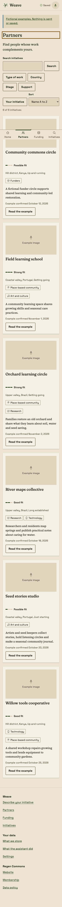
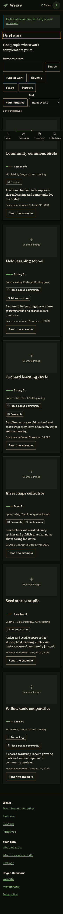
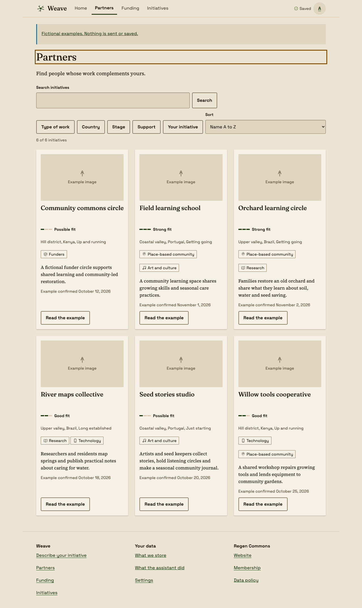
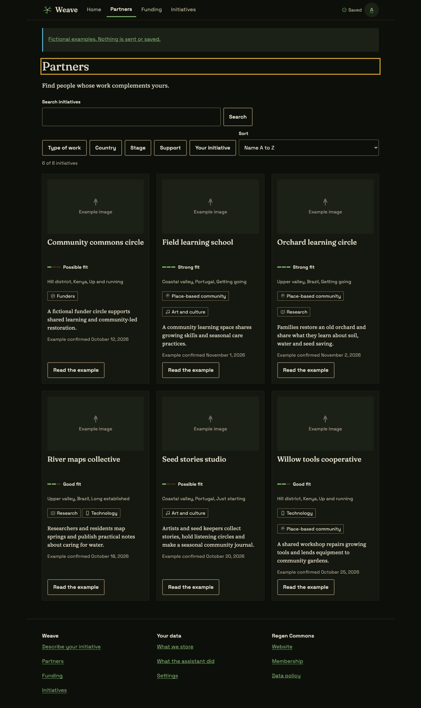

# Step 1 fixture proof

Frame and list patterns in Headless Chrome 149, at 360 × 800 and 1280 × 960, in both themes. These are development fixtures with invented initiatives and funds. They do not establish live saving, sign-in, matching or email delivery. The screenshots show the full page at those viewport widths, including the footer.

| Phone, light | Phone, dark |
|---|---|
|  |  |

| Desktop, light | Desktop, dark |
|---|---|
|  |  |

## Checks

- 27 app route/state cases at each width/theme pair: one heading, a footer, aligned left edges, no horizontal overflow, labelled fields, minimum target size, text size and rendered text contrast. No problems or runtime errors found.
- Ten static example page bodies rendered against the shared CSS at the same four width/theme pairs. Short quiet buttons in the existing intake example exposed a missing minimum width; the Button pattern now supplies it.
- Long-content list smoke checks at 320, 375, 600, 900 and 1440 px; 200 percent root text size; forced colours; and reduced motion with no active animations.
- Keyboard filter opening, checkbox selection, Escape and focus return; removable chips; search with no results; sorting; retry; and information dialog opening and dismissal. Draft and private partner views show no partner cards or names.
- Native tooltips and menus, plus fallback behaviour with interest invokers and Popover API methods disabled in Chrome. This is fallback proof in Chrome, not a Safari or Firefox run.
- Equal card heights, two-line title space, aligned fit lines and bottom actions measured across a desktop row. Padded spans and paragraphs fit their container under border-box sizing.
- Local `/api/health` returns HTTP 200. Production builds exclude fixture records and controls; no backend integration is claimed.

The five-minute review checked hierarchy, page identity, first actions, concise copy, tokens, empty and long content, keyboard access and reduced motion. Full intake, Home, team slots, public detail composition, save/share and data records remain in the later [implementation steps](../../../handover/03-interface-implementation.md#then-build-in-this-order-one-small-draft-pull-request-each). Images remain synthetic until D30 is decided.
