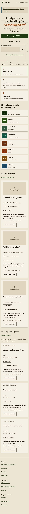
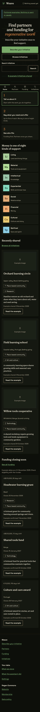
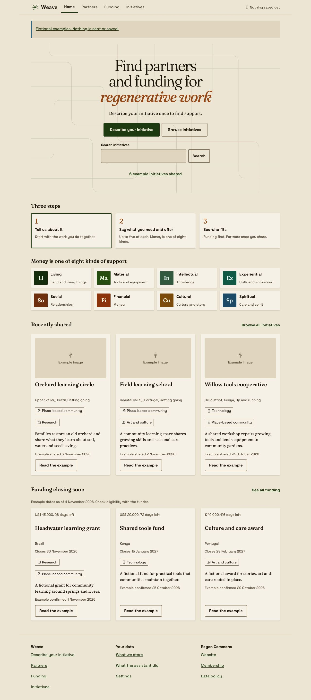
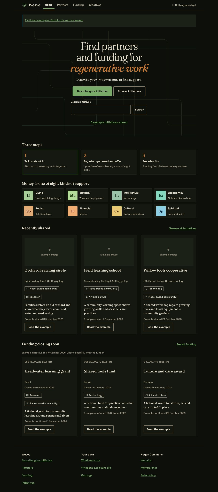

# Step 2 fixture proof

Home in Headless Chrome 149. The screenshots use invented public initiatives and funds, with example dates fixed at 4 November 2026. They show the full page at 360 × 800 and 1280 × 960 viewport sizes, in both themes, with reduced motion. Phone navigation appears at the first viewport's fixed position in the full-page capture.

| Phone, light | Phone, dark |
|---|---|
|  |  |

| Desktop, light | Desktop, dark |
|---|---|
|  |  |

## Checks

- Seven Home states at 360, 375 and 1280 px, in both themes: ready, empty, partial, loading, offline, error and long content. All five parts remain present. Loading and error states show no preview cards; empty shows no invented activity.
- Partners, Funding and Initiatives rechecked at the same widths and themes after sharing the Listing card composition. No horizontal overflow, small targets or text, missing field labels, heading-count problems or rendered text contrast failures in the audited cases. No browser warnings or errors found.
- Home and intake static example bodies rendered against shared CSS at 360 and 1280 px, in both themes. The pattern library's 18 tooltip triggers have distinct IDs and valid targets across the light/dark comparison.
- Keyboard search for “orchard” opens Initiatives with the query and fixture scenario preserved, one result and heading focus. Support tooltips open on focus and dismiss with Escape while keeping focus on the trigger.
- Long Portuguese content with 200 percent root text size and expanded fixture controls passes at 360 px. Forced colours pass and hide the decorative weave. Reduced motion has no active animations.
- Long-content smoke checks pass at 320 and 1440 px. Retry restores all six preview cards; a partial fund without an amount still shows its days left. With motion enabled, the weave moves; its token-based cycle is 12.8 seconds.
- Recently shared uses sharing dates, independently of confirmation. Upcoming deadlines are sorted before limiting to three, include today, and exclude past, unknown, invalid and rolling dates. Calendar-day tests cover daylight saving and leap days. Fixture reference dates and days left are visible; eligibility still belongs to the funder.
- Production bundle checks exclude fixture records and controls. Production shows honest empty states until live feeds exist. No live saving, sign-in, matching or email delivery is claimed.

The five-minute review checked hierarchy, first actions, concise copy, named patterns and tokens, long and empty content, keyboard paths and both themes. The hero keeps start and search on the first phone screen; only the first numbered step is a link. The eight framework titles keep their plain meanings visible and more detail in tooltips. No new dependencies or service changes were needed.

Safari, Firefox and real-device touch remain untested. The conversation begins in [Step 3](../../../handover/03-interface-implementation.md#then-build-in-this-order-one-small-draft-pull-request-each); catalog and public initiative feeds remain Steps 5 and 6. Images remain synthetic while D30 is open.
