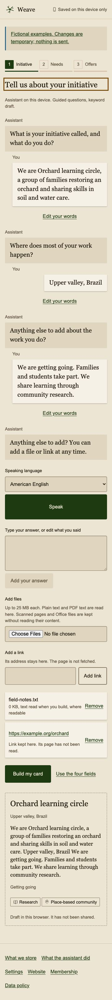
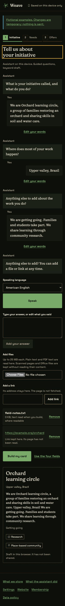
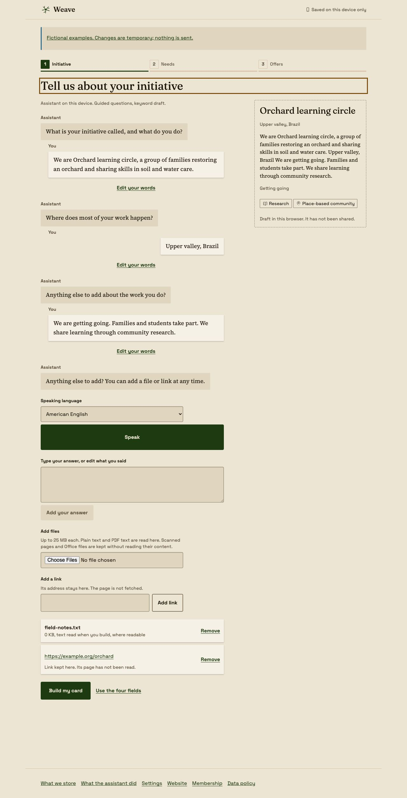
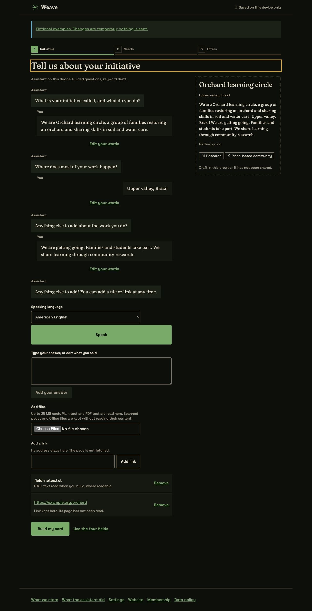
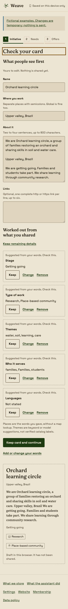
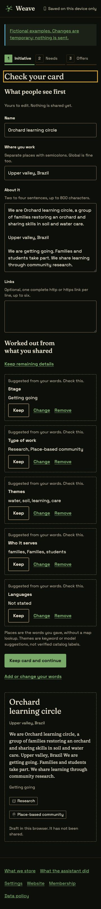
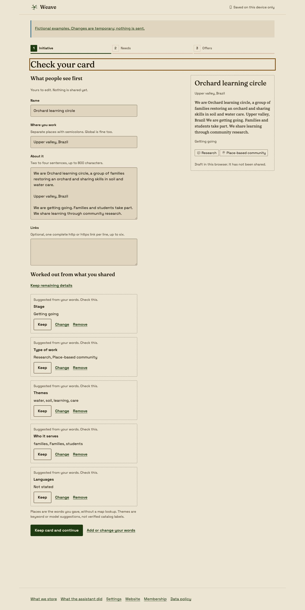
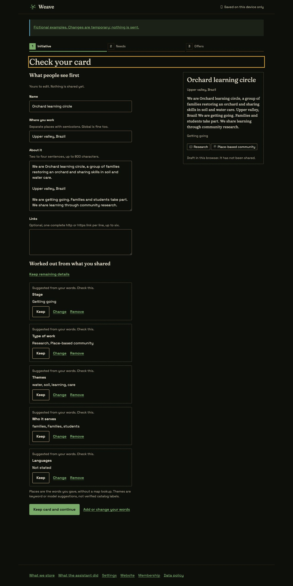

# Step 3 fixture proof

Describe and Check your card in Headless Chrome 149. All words, files and records
used for this proof are invented. Screenshots show full pages at 360 × 800 and
1280 × 960, in both themes with reduced motion. This is fixture proof, including
the local production-build checks below; it is not evidence of a live service or
real-user local AI.

| Describe, phone light | Describe, phone dark |
|---|---|
|  |  |

| Describe, desktop light | Describe, desktop dark |
|---|---|
|  |  |

| Review, phone light | Review, phone dark |
|---|---|
|  |  |

| Review, desktop light | Review, desktop dark |
|---|---|
|  |  |

## Checks

- All 20 Describe views at 360, 375 and 1280 px in both themes: fresh, talking,
  listening, attached, building, offline, speech-error, long, manual, weak,
  download, downloading, download-error, browser, cloud, cloud-error, review,
  correcting, kept and storage-error. No horizontal overflow, text below 12 px,
  targets below 44 px, missing field labels, duplicate IDs, heading-count problems
  or rendered text contrast failures in these audited cases.
- Long, manual, correcting and cloud views also pass at 320 and 1440 px and at
  200 percent root text size on a 360 px screen. Forced colors retain control
  boundaries; reduced motion is honored.
- Keyboard Speak and Finish speaking produce editable fixture words. Build opens
  Check your card at the top with heading focus. Keep, Change, Cancel, Remove and
  Undo work; focus follows the changed control. Continuing requires a name, valid
  public fields, no unfinished corrections and confirmation of derived details.
- Both static pattern examples pass at 360 and 1280 px in both themes. Editing
  words, adding local references and keeping/removing/undoing proposals work
  without a service. The examples say their changes stay in the current page.
- A separate, isolated browser context runs the production build on port 4174
  with the checked-in production CSP. A generated 820-byte, two-page PDF has one
  page of invented Orchard text and one blank page. The real PDF and keyword
  Workers extract the text, report one unread page and retain all original bytes.
  Rebuilding works with network requests blocked and the service worker active.
  No CSP violations or requests to other origins occur.
- Real IndexedDB reloads retain unfinished composer text, a pending link, an open
  Themes correction, file bytes and extraction reports. Two real tabs prove the
  revision check: the newer stored words remain intact, while the stale tab shows
  a conflict and retains its words for recovery. Unit tests also cover quota
  failure, retry, blocked reads, stale model output and cancellation cleanup.
- Native speech/model tests use injected capabilities to prove local-only checks,
  no implicit downloads, schema validation, one retry and session cleanup. The
  production bundle excludes invented records and download/cloud simulations.

The five-minute review checked hierarchy and first actions, one question at a
time, concise copy, named patterns and tokens, empty/long/Portuguese/error content,
keyboard paths and both themes. The card follows the conversation on phones and
sits beside it on wide screens. Derived details stay in pencil until confirmed;
full source words remain available when the public description is shortened.

Validation uses `bun install --frozen-lockfile`, `bun run ci` and
`git diff --check`. CI includes the root catalog build and tests, design-system
checks, app/API builds and tests, typechecks, guidance and harness tests.

Safari, Firefox, real microphones, native browser-model hardware, touch and
performance on a mid-range phone remain untested. D32 still needs exact model
manifests, hosting approval and participants for local-AI evidence by 20 November
2026. D35 blocks live cloud consent and calls. Office/OCR parsing needs separate
dependency approval; geography stays in the person's own words pending D33. Needs,
offers and finish remain Step 4. No saving, sign-in or sharing service is claimed.
