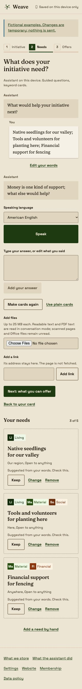
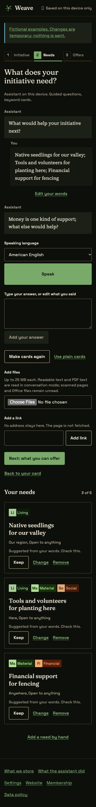
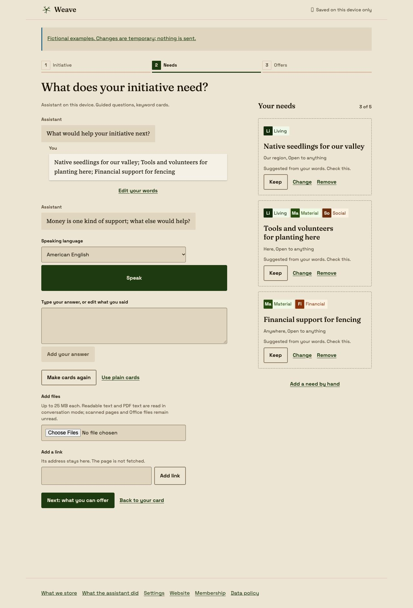
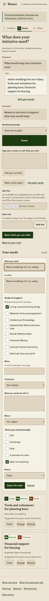
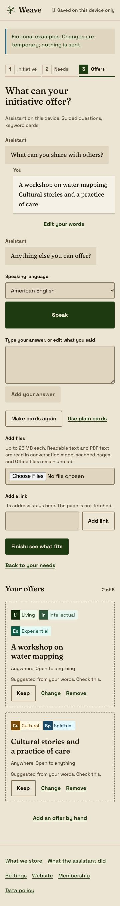
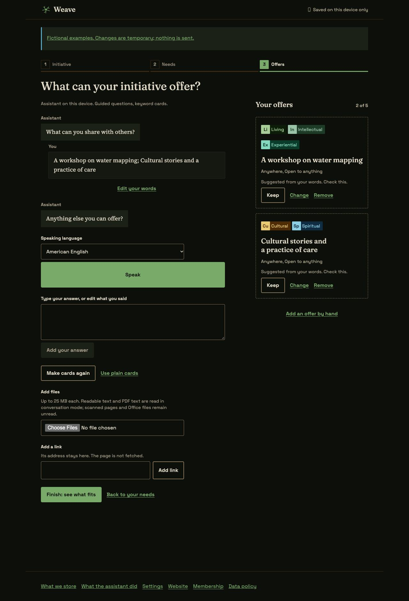
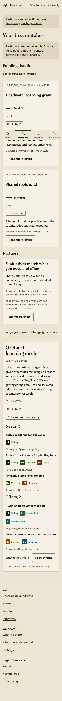
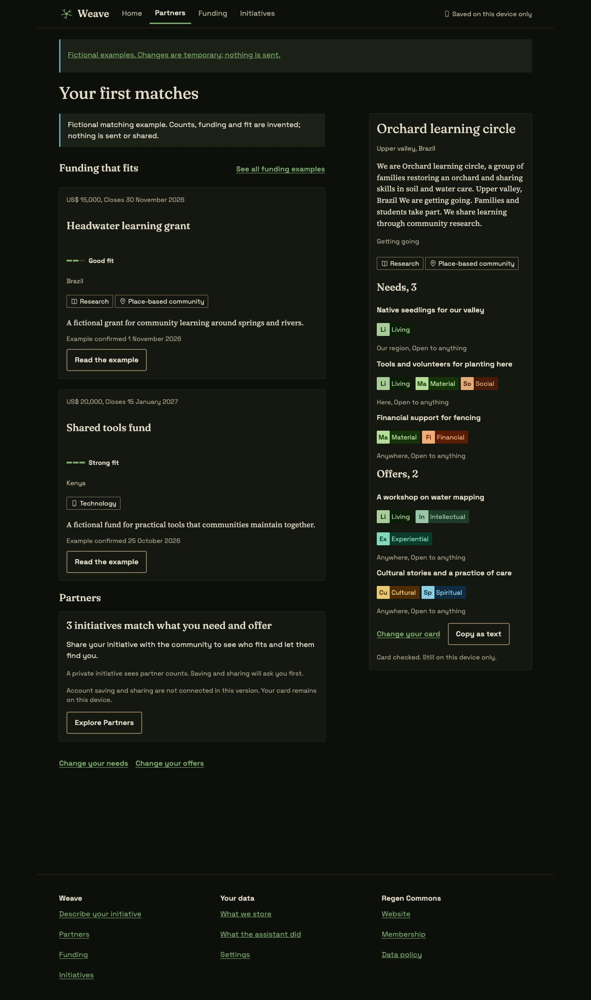

# Step 4 fixture proof

Needs, Offers and Finish with invented words and files. App checks use Brave
DevTools with Headless Chrome 156. The prototype reference was also walked in
Headless Chrome 149 at 360 and 1280 px, in both themes. Final correction/undo and
static-example interaction checks also use Headless Chrome 149. These are fixture checks,
including the local production build; they do not prove live matching or services.

| Needs, phone light | Needs, phone dark |
|---|---|
|  |  |

| Needs, desktop light | Need editor, phone light |
|---|---|
|  |  |

| Offers, phone light | Offers, desktop dark |
|---|---|
|  |  |

| Finish, phone light | Finish, desktop dark |
|---|---|
|  |  |

## Checks

- Thirty app cases at 360, 375 and 1280 px in both themes: eleven Needs and eleven
  Offers views (ready, empty, loading, offline, error, long, editing, removed, kept,
  manual and storage-error), plus eight Finish views (ready, empty, loading,
  offline, error, long, saved and shared). No horizontal overflow, text below 12 px,
  targets below 44 px, missing field labels, duplicate IDs, heading-count problems
  or rendered text contrast failures in these audited cases. The Finish error
  notice uses the Notice body/action structure to keep its retry button in bounds.
- Long and editing cases also pass at 320 and 1440 px. Long, editing, manual and
  Finish error cases pass at 200 percent root text size on a 360 px screen. Forced
  colors retain boundaries; reduced motion has no active animations.
- Keyboard Keep moves focus to Change, Remove moves it to Undo, and Undo returns
  to Change with the counter restored. Change focuses its editor. Selecting and
  keeping all eight kinds produces eight equal tags and returns focus to Change.
- A kept correction survives Remove, Undo and rebuilding as a kept card. A
  regression check first reproduced its loss of kept state, then passed with the
  prior decision restored. The browser repeats this recovery successfully.
- A fixture speech turn produces a fourth card and editable spoken words. Moving
  unfinished words into manual mode retains them. Keep notes stores them without
  adding cards or another extraction attempt. The assistant record identifies the
  Needs step without retaining its words.
- The three new static examples render in native frames at 360 and 1280 px in
  both themes. Their notes, review, removal, undo and selectable text-copy controls
  stay within the current page; no service is implied.
- A fresh local production build completes Describe, Check your card, two needs,
  one offer and Finish by typing. Heading focus follows navigation. The checked
  card is copied, the live partner count stays unknown, and the three local run
  records each contain zero cloud words. No requests to other origins occur.
- Real IndexedDB reload retains an open need editor with `12,` and `BR` as raw
  unfinished amount/currency values, unfinished notes and `https://` as a pending
  link. Unit tests also prove compatibility with old Describe drafts, independent
  step versions, storage recovery and the existing conflicting-tab writer.
- Offers reads a generated 820-byte, two-page PDF through the real same-origin
  PDF and keyword Workers under the unchanged production CSP. The blank page is
  reported; all original bytes remain stored. Rebuilding succeeds with network
  requests blocked and the service worker active, with no CSP violations or
  external requests. A cold offline reload remains a real-device check because
  the automated browser restarted during that attempt.
- Core checks cover all eight kinds, five-card overflow and slot recovery,
  corrected/removed cards across source edits, unsafe links, incomplete fields,
  amount/range validation, empty steps, one money nudge, model source references
  and count consistency, stale review and checked-card copying.

The five-minute review checked hierarchy and first actions, concise prompts,
named patterns and tokens, empty/long/Portuguese/error content, keyboard focus and
both themes. Cards follow the conversation on phones and sit beside it on wide
screens. The counter stays visible with its list; every kind has equal treatment.
Finish keeps the checked card together with funding and the share explanation.
Unknown feeds keep their counts unknown and expose no unconnected email controls.

Validation uses `bun install --frozen-lockfile`, `bun run ci` and
`git diff --check`. CI includes the root catalog build/tests, all app/API and
design-system checks, typechecks, guidance and harness tests. New dependencies,
deployment configuration, CSP and generated tokens are unchanged.

Real microphones, native browser-model hardware, Safari, Firefox, touch and
mid-range-phone performance are unverified. D32 still needs model manifests,
hosting approval and people for local-AI evidence by 20 November 2026. D35 blocks
live cloud calls. Catalog/matching feeds and account saving/sharing remain the
following steps; Office/OCR parsers and mapped places retain their existing gates.
