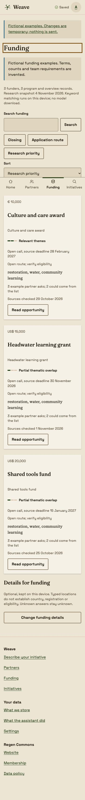
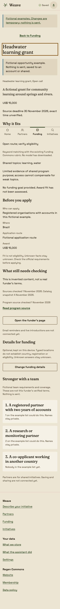
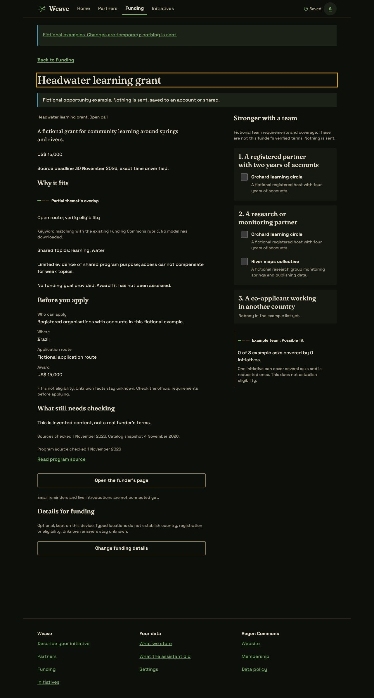

# Step 5 fixture proof

Funding and opportunity detail, with invented initiatives and team requirements.
These are fixture checks, including the local production build. The real catalog
is the committed research snapshot, not newly verified funding advice or a live
service. App audits use Headless Chrome 149; screenshots use Headless Chrome 156
through Brave DevTools.

| Funding, phone light | Private team counts, phone light |
|---|---|
|  |  |

## Checks

- Walked Funding and opportunity detail through all 17 prototype states at the
  360 px frame and 1280 px viewport in both themes: 68 reference renders.
- Audited 17 app cases at 360, 375 and 1280 px in both themes: 102 renders. Cases
  cover visitor, ranked, empty, loading, offline, error, long and filtered Funding;
  shared, private, no-candidate, no-partner, loading, offline, error and long
  opportunity detail; and a missing exact record. No overflow, text under 12 px,
  targets under 44 px, missing labels, duplicate IDs, heading-count problems or
  rendered text contrast failures remain. A narrow Sort field found at 375 px
  was fixed in the shared filter bar and the affected check repeated.
- Another 24 checks cover long Portuguese content, partial funding data and
  visitor detail at 320, 360 and 1440 px, in both themes. The 360 px cases use
  200 percent root text. The three static examples pass at 360 and 1280 px in
  both themes, for 12 additional renders.
- Shared team selection mirrors the same initiative across two asks. Coverage
  reports two asks and one initiative; review lists that recipient once. Private
  views contain counts without candidate names. The example request is reviewed
  in a native dialog and sends nothing. Live reminders and introductions are
  absent until the saving and email adapter exists.
- A local production build completes the typed initiative, two needs, one offer,
  Finish and Funding flow. Real local keyword scoring produces 24 visible cards,
  with no external requests. A legacy fund/program link opens the exact SEED
  cycle; answering a sourced prerequisite No produces a known conflict without
  turning thematic fit into eligibility approval.
- Raw `br, CO`, `12,` and `BR` funding edits remain in the open editor across a
  real IndexedDB reload and a validation error. Kept funding details and condition
  answers use the existing atomic device writer; old drafts gain blank defaults.
- A fresh build loads and re-ranks the cached catalog after reload with HTTP
  requests blocked and the service worker active: 24 cards, 24 fit signs, no
  error notices, no external requests and no CSP violations. An uncached request
  is confirmed blocked. DevTools does not change `navigator.onLine` in this
  browser, so the offline notice itself is checked through labelled fixtures.
- A startup listener caught Zod's optional code-generation probe under the
  existing CSP. The shared interpreter configuration removes it in the page and
  Workers. A regression test replaces code generation with a throwing proxy and
  verifies that device/extraction schemas make zero probes. Fresh production
  startup, scoring and the network-blocked reload report no CSP violations.
- Core checks retain all 699 funders and 768 unique entries: 727 programs and
  41 overview records. Program results agree with the existing engine's best
  results using the full-corpus index. Missing screening data remains
  provisional; exact links, source warnings, raw field errors and distinct team
  coverage are checked independently.

The five-minute review checked first actions, hierarchy, source dates, unknown
terms, named patterns, both themes and phone/wide layouts. Opportunity details
and team slots share the page edge and stack on phones. Fit remains separate
from readiness. Source links say where they lead. Search has a visible label,
menus and removable chips; private initiatives reveal no candidate identities.

Validation uses `bun install --frozen-lockfile`, `bun run ci` and
`git diff --check`. No dependency, lockfile, generated token, catalog research,
CSP or deployment setting changes. Vite bundles and precaches the public catalog;
private drafts stay in IndexedDB. The root matching modules and live site remain
in place instead of being moved as the earlier migration plan suggested.

## Still needs people

D29 still needs steward-checked requirements, official sources and an explained
multi-partner scoring contract. D34 still needs the maker and catalog steward to
confirm visitor browsing. Live account saving, reminders, introductions and
cross-origin saved-profile/favourite/note import need the later saving adapter
and migration work. No other origin's local storage is read here.

Safari, Firefox, touch, screen-reader sessions and mid-range-phone performance
remain unverified. Real model hardware, hosting and participants for local-AI
evidence by 20 November 2026 remain D32; D35 still blocks cloud integration.
Supabase access/migrations, sign-in email and the subdomain remain separate work.
